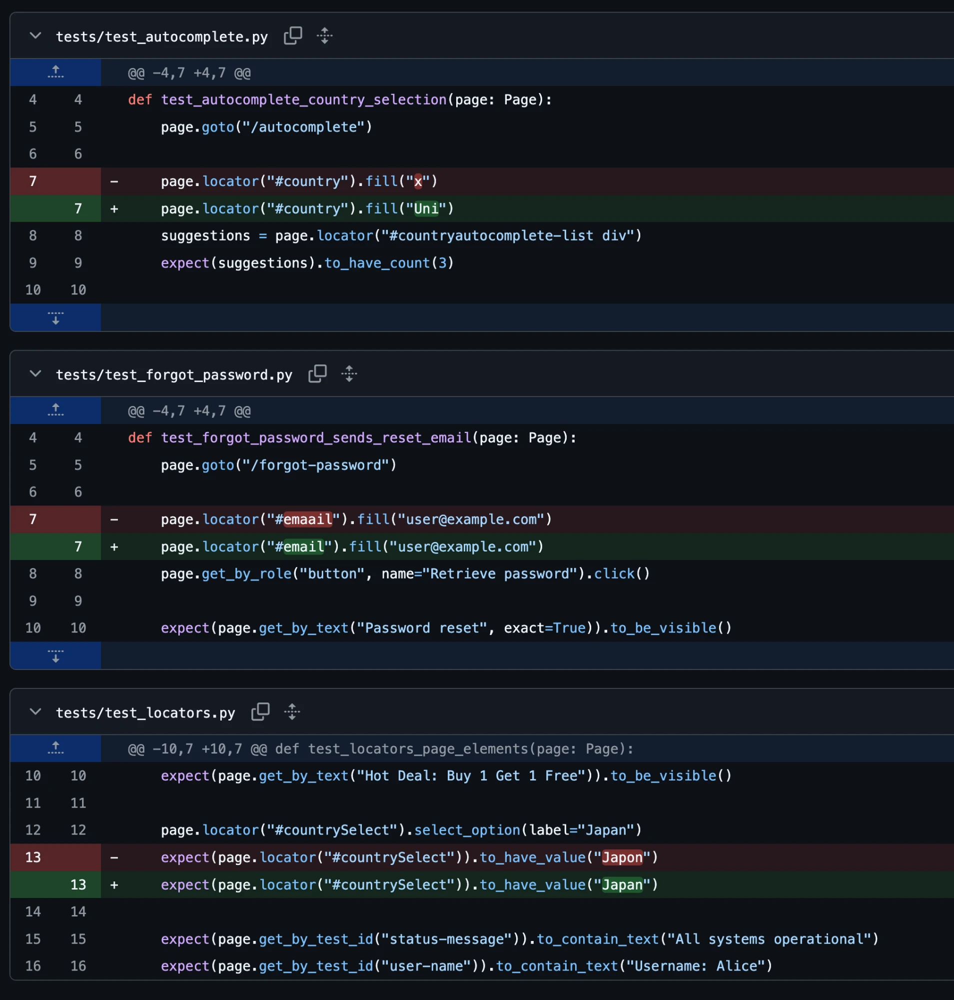

# TestPilot AI

An AI agent that investigates failing UI tests and proposes a fix for human review.

A demo project: Python + Playwright tests, GitHub Actions, and Claude Code driving a
browser through the [Playwright MCP](https://github.com/microsoft/playwright-mcp) server.

## How it works

1. A developer opens a pull request.
2. GitHub Actions runs the Playwright tests and publishes a report (summary, HTML report,
   traces and screenshots).
3. If a test fails, the `ai-investigation` job starts an AI agent. It reads the failure
   report, inspects the test code, and uses Playwright MCP to open the real site and
   reproduce the problem.
4. The agent decides whether the **test** is wrong (it fixes it) or the **site** is broken
   (it leaves the tests alone and says so), then verifies the fix with `pytest`.
5. A **draft PR** is opened against the failing branch with the patch and an explanation.
   Nothing is merged or deployed automatically.

## Example: what the agent fixes

Three tests were broken on purpose with small typos. The agent's draft PR repaired all
three:



| Test | Broken | Agent's fix |
|---|---|---|
| `test_autocomplete.py` | typed `"x"`, so the suggestion count was wrong | `"Uni"` |
| `test_forgot_password.py` | locator `#emaail` | `#email` |
| `test_locators.py` | expected value `"Japon"` | `"Japan"` |

## Project layout

```
tests/                   Playwright UI tests (practice.expandtesting.com)
scripts/summary.py       Turns JUnit XML into the job summary
.github/workflows/       CI: tests, report, AI investigation job
.github/ai/              Agent prompt and Playwright MCP config
```

## Run the tests locally

Requires Python 3.14+ and [uv](https://docs.astral.sh/uv/).

```bash
uv sync
uv run playwright install chromium
uv run pytest
```

## Set up the AI agent

Add a repository secret named `ANTHROPIC_API_KEY`
(Settings → Secrets and variables → Actions).

Also enable Settings → Actions → General → Workflow permissions →
**Allow GitHub Actions to create and approve pull requests**, so the workflow can open the
draft PR.

## Try it

Create a branch, break a test (for example change a locator), and open a PR. The tests
fail, the agent investigates, and a draft PR with the fix appears.
